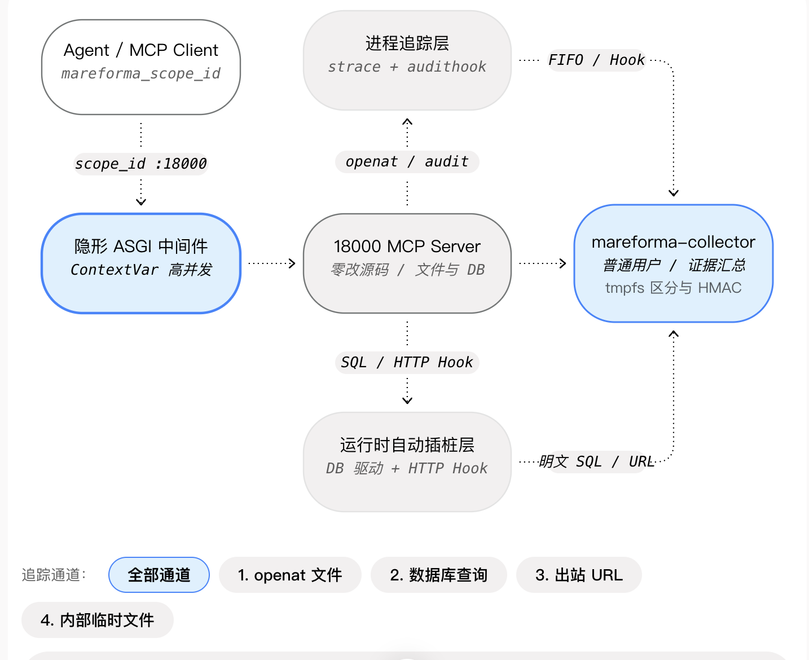
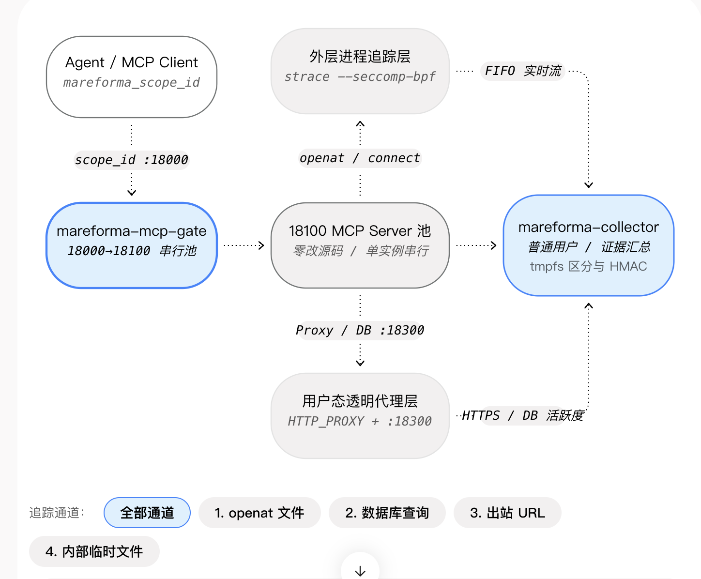

不修改一行 MCP-server 代码、且继续保持**免 `sudo**`，完全可以解决这 4 个问题；唯一的物理前提是**你掌控 18000 端口进程的启动命令与环境变量**（如果是远端他人托管、连启动参数都碰不到的黑盒进程，则物理上不可能采集 `openat()` 和临时文件）。

真正卡脖子的不是“怎么抓到这 4 类事件”，而是**长驻 HTTP 服务的确定性归因**：18000 端口一旦并发处理两个请求，外围抓到的 `openat()` 和出站请求到底属于哪一次 Tool Call？在不引入时间窗猜测的前提下，可以通过“零侵入三明治包装”**与**“零代码运行时注入”两条路线彻底解决。

---

## 一、4 个问题的零改代码捕获机制与隐蔽陷阱

下表把你要解决的 4 个目标拆成两层手段：**通用外围层（任意语言二进制可用）**与**运行时零代码注入层（Python / Node.js MCP 首选）**，并标出了最容易漏掉的 3 个工程坑：

| 目标问题 | 通用外围层（OS / Proxy，零语言依赖） | 运行时零代码注入（如 Python `sitecustomize.py`） | 必须规避的隐蔽陷阱 |
| --- | --- | --- | --- |
| **1. 进程内 `openat()**` | 启动时外层套 `strace --seccomp-bpf -f -y -e trace=open,openat,openat2,connect,execve` 写命名管道（FIFO） | `sys.addaudithook("open")` 捕获 Python 文件读取 | `addaudithook` 漏掉 C 扩展（`duckdb`/`sqlite3`/`numpy` 底层直调 `openat`），需外层 `strace` 补齐 |
| **2. 查询了哪个数据库** | ① 本地嵌入式库（SQLite/DuckDB）由 `openat` 捕获；② 远程库改 `DATABASE_URL`/`PGHOST` 走本地轻量 TCP 转发代理 | 自动挂接驱动 Hook（或直接复用 `opentelemetry-instrumentation-*` 覆盖 `psycopg`/`asyncpg`/`pymysql`/`sqlalchemy`/`redis`/`pymongo`） | **连接池大坑**：长驻 server 复用预建好的 DB 连接池，单次查询**不会再触发 `connect()**`，单靠 `strace -e connect` 会彻底漏抓！必须走本地转发代理或驱动 Hook |
| **3. 自己请求了哪个 URL** | 启动环境变量注入 `HTTP_PROXY` / `HTTPS_PROXY` + 用户态自签 CA（`SSL_CERT_FILE` / `REQUESTS_CA_BUNDLE`）导向本地出站代理 | 自动 Hook `httpx` / `aiohttp` / `urllib3` / `requests`，发请求前直接记下明文 URL | 不配用户态 CA 时，HTTPS 代理只能经 `CONNECT` 拿到 `host:port`，拿不到完整 Path/Query；另需用 `strace connect` 监测进程是否绕过代理直连外网 |
| **4. 内部读取的临时文件** | `strace` 捕获 `/tmp`、`/var/tmp` 及 `$TMPDIR` 下的 `openat`（同时记录写与读） | `sys.addaudithook` 捕获 `open` 与 `tempfile` 操作 | **语义区分关键**：必须把“本请求先写后读的内部临时文件”与“外部预先存在的未知 `/tmp` 文件”拆开，否则会把正常缓存误报为 `OPAQUE` |

---

## 二、两套确定性落地架构（不改 MCP 源码、零置信度猜测）

根据固定监听 18000 端口的 MCP Server 的实现语言和并发要求，在 `mareforma_pro` v0.4.0 中建议提供两条互补路径，最终对外统一封装为一条免 `sudo` 启动器命令（例如 `mareforma-wrap --port 18100 -- <原启动命令>`）。Supervisor 使用对外 18100，原服务继续使用内部 18000。

### 方案 A：Python / Node.js MCP 首选 —— 零代码运行时注入（原生支持高并发）

绝大多数 MCP Server 基于 Python（FastMCP / Official MCP SDK / Starlette / Uvicorn）或 Node.js。你可以沿用 `opentelemetry-instrument` 的经典思路：**不改业务源码，仅通过启动环境变量注入前置脚本**。

```bash
# 零改代码启动原 18000 MCP Server（Python 示例）
PYTHONPATH="/path/to/mareforma_pro/autohook:${PYTHONPATH}" \
MAREFORMA_COLLECTOR_URL="http://127.0.0.1:8787" \
  python3 -m your_mcp_server --port 18000

```

Python 启动时会自动加载 `PYTHONPATH` 里的 **`sitecustomize.py`**，在 MCP Server 代码执行前完成 4 件事：

1. **解决高并发确定性归因（核心）**：自动给 ASGI / WSGI / `http.server` 入口打轻量补丁，拦截每一次入站 MCP HTTP 请求，提取 Header（`X-Mareforma-Scope-Id`）或 JSON-RPC `params._meta.mareforma_scope_id`，绑定到 `contextvars.ContextVar`。Python `asyncio` 协程切换会自动携带 `ContextVar`，哪怕 18000 端口同时处理 50 个并发 Tool Call，每条事件都 100% 确定性归属对应 `scope_id`。
2. **DB 查询精确到库名与表/SQL**：自动插桩 DB-API / SQLAlchemy / `asyncpg` / `sqlite3` / `redis` / `pymongo`，即使数据库走 TLS 加密且启用长连接池，依然能确定性记录“连了哪个实例、哪个库、执行了什么查询”。
3. **出站 URL 无证书明文采集**：自动插桩 `httpx` / `aiohttp` / `urllib3` / `requests`，直接捕获完整 HTTPS URL 与 HTTP 状态码，完全不用折腾本地 CA 证书信任问题。
4. **文件与临时文件**：挂 `sys.addaudithook("open")` 捕获 Python 层所有文件与临时文件读取（若需覆盖 C 扩展直调的 `openat()`，可按方案 B 叠加外层 `strace`）。

---

### 方案 B：任意语言黑盒 MCP 通用 —— “三明治”外围包装 + 串行化闸门

如果 18000 端口是 Go / Rust / C++ 编译的二进制，或者 Python Server 重度依赖 C 扩展和外部子进程，必须靠 OS 层与网络层全覆盖。此时要守住“拒绝时间窗猜测”**的底线，关键是在入口加一道**串行化闸门（Worker Pool）。

#### 三层外围拓扑（零代码、纯用户态）

1. **入站层：`mareforma-mcp-gate`（监听 18100，消除并发重叠）**
* MCP Server 保持固定监听 `127.0.0.1:18000`，由 `mareforma-mcp-gate` 对外监听 `18100`。
* Gate 收到 HTTP 请求后读取 `scope_id`，按单实例 **`max_concurrency = 1` 串行队列**转发给 `18000`。固定端口只能支持一个内部实例；只有服务本身支持端口参数时，包装器才能启动 N 个无状态实例，并为每个实例配置独立 `strace` 管道与代理通道。
* 请求放行前通知 Collector `ACTIVATE(instance_id, scope_id)`，响应返回后通知 `DEACTIVATE`——彻底消灭同进程并发重叠导致的归因歧义。


2. **进程层：常驻 `strace --seccomp-bpf` + 命名管道流式采集**
* 用命名管道（FIFO）替代落地大文件，实时喂给 `mareforma-collector`：
```bash
strace --seccomp-bpf -f -y -qq \
  -e trace=open,openat,openat2,connect,execve \
  -o /tmp/mf_mcp_18000.fifo \
  -- your_mcp_server --host 127.0.0.1 --port 18000

```


* **全量覆盖 ① `openat()` 与 ④ 临时文件**：无论什么语言或 C 扩展，所有文件打开都会带上绝对路径流向 Collector。
* **DB 连接补丁（破除连接池盲区）**：若 MCP Server 通过环境变量配置数据库（如 `DATABASE_URL`），包装器在本地起一个轻量 TCP 透明转发端口（如 `127.0.0.1:18300` 转发至真实数据库），并把 `DATABASE_URL` 改写指向 `18300`。这样每次复用长连接池发包时，本地代理都能确定性感知“当前 `scope_id` 期间向哪个数据库实例发送了查询字节”，并可按需嗅探 Postgres/MySQL 握手阶段上报的 `database_name`。


3. **出站层：本地透明代理 + 防绕过检测**
* 启动原 MCP Server 时注入 `HTTP_PROXY`、`HTTPS_PROXY` 及用户态自签 CA（`SSL_CERT_FILE`、`REQUESTS_CA_BUNDLE`、`NODE_EXTRA_CA_CERTS`），所有外发请求流经本地代理 `127.0.0.1:18200`，直接记录完整 URL。
* **Fail-Closed 防绕过**：同时比对 `strace` 捕获的 `connect()` 目标 IP:Port。如果进程忽略了代理环境变量、直接向外部公网 IP 发起了 `connect()`，Collector 立即追加 `opaque_reason="proxy_bypassed_egress"`，绝不假装没看见。


---

## 三、专门针对第 4 点的语义升级：区分“自产自销临时文件”与“外部未知临时文件”

在 `mareforma_pro` 0.2.0 的 `bwrap` 逻辑里，读 `/tmp` 文件通常直接标为 `unmapped_tmpfs` 并触发 `OPAQUE`。但放到长驻 MCP Server 里，这个规则会制造大量误报——很多正常工具都会把中间结果先写进 `/tmp/tmpXXXXXX`，再交给解析器读回来。

只需要在 `strace` 解析器里加一个**每 `scope_id` 的写集合 `created_or_written_tmp**`，就能精准区分两种性质完全不同的临时文件读取：

* **先写后读（本 `scope_id` 内先捕获到 `O_WRONLY`/`O_RDWR`/`O_CREAT` 打开 `/tmp/abc`，随后捕获到读 `/tmp/abc`）**：记入新字段 **`internal_temp_files`**（透明审计记录，**不触发 `OPAQUE**`，因为数据来源闭环在当前请求内部）。
* **凭空读取（本 `scope_id` 内从未写过 `/tmp/xyz`，却直接打开读取）**：说明读入了历史残留或外部进程放入的未知数据，继续严格 Fail-Closed，标为 **`OPAQUE (unmapped_tmpfs)`**。

---

下方交互式架构图展示了不修改 MCP-server 代码的**免 `sudo` 零侵入观测方案**。你可以切换顶部的模式按钮，对比「方案 A：运行时零代码注入（Python/Node 高并发）」**与**「方案 B：通用三明治包装 + 串行闸门（任意语言）」，也可以点击底部 4 个追踪目标开关，直观查看每类信号如何在无特权环境下被确定性捕获并归因到 `scope_id`：

方案A: Python/Node 零代码注入


全通道零侵入观测总览
方案 A · 运行时注入 + strace 兜底
方案 A 适合 Python/Node 服务：通过 sitecustomize.py 自动注入 ASGI 中间件与驱动/HTTP 插桩，支持高并发 ContextVar 归因，并辅以 strace --seccomp-bpf 覆盖 C 扩展。

入站闸门 / Supervisor（18100）
方案 A · sitecustomize.py 自动注入
通过 PYTHONPATH 加载 sitecustomize.py，在进程初始化时自动包装 ASGI/WSGI 入口，将 mareforma_scope_id 写入异步安全的 ContextVar，原生支持高并发请求并行处理。

免 sudo 启动 / 注入配置
PYTHONPATH=/opt/mareforma/pyhook:$PYTHONPATH \
MAREFORMA_COLLECTOR_SOCK=/tmp/mf-collector.sock \
uvicorn mcp_server:app --host 127.0.0.1 --port 18000
防漏细节与已知边界
ContextVar 仅在同协程/线程上下文内有效；若业务代码派生子进程或使用 C 扩展线程池，需由外层 strace 补齐。

方案B: 通用三明治外围包装


全通道零侵入观测总览
方案 B · 三明治外围包装 + 串行归因
方案 B 语言无关：外置 Supervisor 监听 18100，并向固定监听 18000 的原 MCP Server 单实例串行放行，彻底消除并发归因重叠，结合 strace + 用户态代理实现全量确定性采集。

入站闸门 / Supervisor（18100）
方案 B · mareforma-mcp-gate 外置闸门
由外置 mareforma-mcp-gate 监听 18100 端口，将请求转发到固定监听 18000 的原 MCP Server，并对该实例实施单请求串行放行，从根本上消除多线程/多协程并发归因重叠。

免 sudo 启动 / 注入配置
mareforma-mcp-gate \
  --listen 127.0.0.1:18100 \
  --upstream 127.0.0.1:18000 \
  --serial-per-instance --collector-sock /tmp/mf-collector.sock
防漏细节与已知边界
固定监听 18000 时只能运行一个被托管的 MCP 实例。若服务支持端口参数，可改为多内部实例池以平衡吞吐量与确定性归因。

---

### 给 `mareforma_pro` v0.4.0 的直接落地建议

先确认一下你这个 18000 端口的 MCP Server 是不是 Python 写的：

* **如果是 Python 写的**：优先做 **方案 A（`PYTHONPATH` + `sitecustomize.py` 自动注入）**，只需要一个约 150 行的注入包就能在支持高并发的同时，把 DB 查询、明文 HTTPS URL、Python 文件与临时文件全拿下；如果它里面还调了 C 扩展或外部二进制，再外挂一层 `strace` 补齐 `openat()`。
* **如果是非 Python 或多种语言混杂**：直接做 **`mareforma-wrap` 通用外围启动器**（18100 串行闸门 + 内部固定 18000 的 MCP Server + `strace` FIFO + 本地 HTTP/DB 代理），一套工具通吃所有 HTTP MCP Server。
