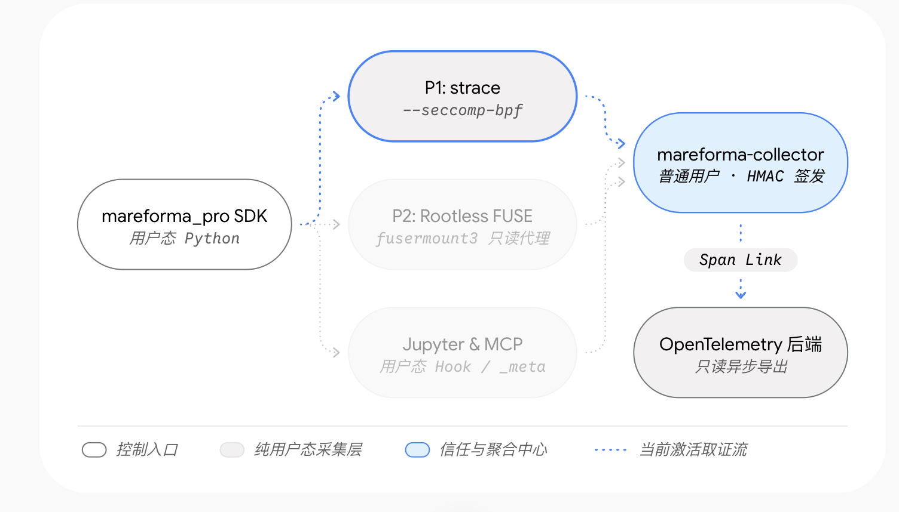
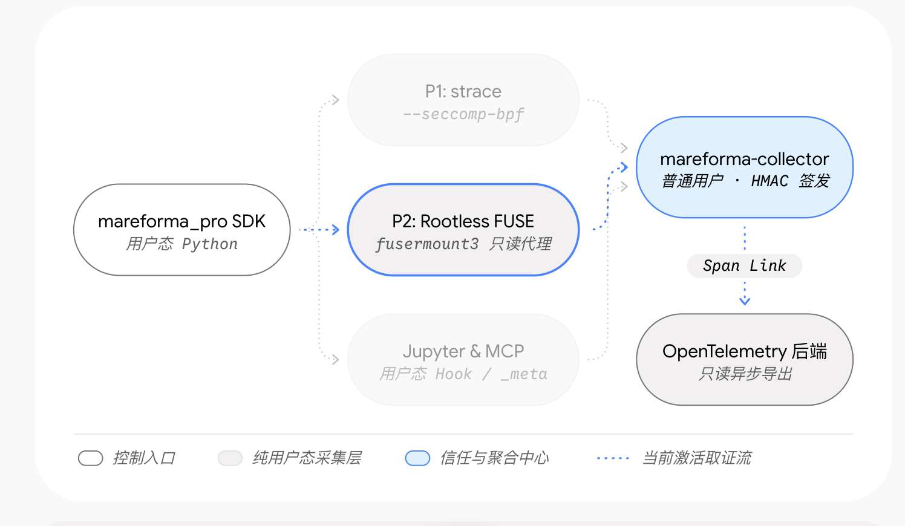
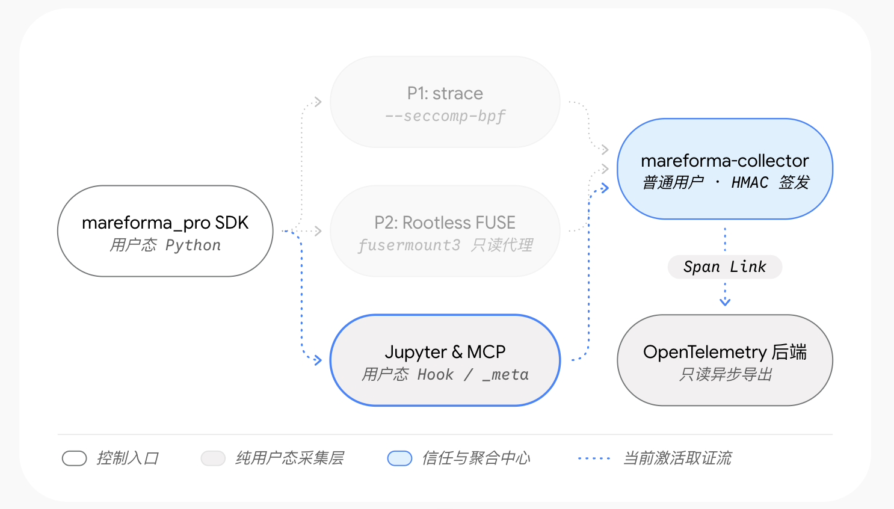

这套 **`mareforma_pro` v1 纯免 `sudo`（Rootless）完整方案**完全基于普通用户权限设计，适配高校 GPU 集群、Slurm 节点与多人共享 Linux 服务器（已在你的 `gpu3` 实测打通 `strace 5.16 --seccomp-bpf` + 非 setuid `bwrap`）。

`mareforma-pro` 是独立发布的发行包名，Python import 名为 `mareforma_pro`，依赖核心 `mareforma` 包并独立做版本与发布；不要在 `mareforma` 核心 wheel 中混装 `mareforma_pro`。

核心底线不变：**彻底淘汰概率置信度与时间窗猜测**。每一条观测证据均由确定性归因产出；凡超出免 `sudo` 观测边界的行为，一律诚实标记为 `OPAQUE` 并附带明确原因。

---

## 一、纯免 `sudo` 四模块架构全景

无需任何内核特权、无需编译 eBPF C 代码、无需管理 cgroup。整个系统由 **4 个纯用户态组件**组成，统一通过全局唯一的 `scope_id` 串联：

| 模块 | 实现形态 | 核心职责 | 确定性归因机制（零置信度） |
| --- | --- | --- | --- |
| **① `mareforma_pro` SDK** | 改造 `mareforma` 源码（Python） | 保留原版 `observe()` / `assert_claim()`；将内部 `mint` 注册表抽离为 `EvidenceBackend` | 控制面入口，生成 `scope_id` 并校验 HMAC 收据 |
| **② 本地进程 / `bwrap` 采集器** | **P1 默认**：`strace --seccomp-bpf -f -y`；**P2 备选**：`fusermount3` 只读代理 | 穿透子进程树与 `bwrap` 沙箱捕获真实文件读取与进程派生 | **按 `scope_id` 独占日志流或挂载点**，并发 Tool Call 物理隔离、零串台 |
| **③ 长驻进程 / MCP 中间件** | 轻量 Python Hook（用户态） | 覆盖 Jupyter Kernel、自建远端 MCP Server 与第三方黑盒 MCP | Jupyter 走 Cell 生命周期 Hook；MCP 走 `params._meta` 透传 `scope_id` |
| **④ `mareforma-collector**` | 轻量 Python 服务（Unix Socket / HTTP + SQLite） | 统一汇总证据、执行 `mount_map` 路径还原、签发 HMAC 收据、异步导出 OTel | 唯一收据签发源；OTel 异步解耦，导出失败不影响 Grounding 判定 |

---

## 二、`mareforma` 源码最小化改造设计

原版 `mareforma` 跨进程降级为 `OPAQUE` 的根因，在于 `assert_claim()` 只信任本进程内存的 `mint` 注册表。v1 改造只动 **3 处核心抽象**，100% 兼容原版单进程用法：

### 1. 抽离 `EvidenceBackend` 插件接口

* **`InProcessBackend`（默认）**：维持原版 `contextvar` + 进程内注册表，零额外配置。
* **`CollectorBackend`（`mareforma_pro` 模式）**：进入 `observe()` 时向本地/同网段 `mareforma-collector` 注册 `scope_id`；退出时拉取带 HMAC 签名的 `ScopeEvidence`。

```python
from abc import ABC, abstractmethod
from dataclasses import dataclass, field
from typing import Dict, List, Optional

@dataclass(frozen=True)
class ScopeEvidence:
    scope_id: str
    observed_files: List[str]          # 已还原为宿主机/逻辑路径的已读文件
    observed_dirs: List[str] = field(default_factory=list)   # 仅列目录（O_DIRECTORY）
    payload_digests: List[str] = field(default_factory=list) # 外部黑盒 MCP 响应 SHA-256
    opaque_reasons: List[str] = field(default_factory=list)  # 非空代表存在明确观测盲区
    hmac_signature: Optional[str] = None

class EvidenceBackend(ABC):
    @abstractmethod
    def open_scope(
        self,
        scope_id: str,
        mount_map: Optional[Dict[str, str]] = None,
    ) -> None: ...

    @abstractmethod
    def close_and_fetch(self, scope_id: str) -> ScopeEvidence: ...

    @abstractmethod
    def verify_receipt(self, evidence: ScopeEvidence) -> bool: ...

```

### 2. 用轻量 HMAC 替代进程内内存查表

* `mareforma-collector` 与 SDK 共享用户态环境变量 `MAREFORMA_HMAC_SECRET`。
* `assert_claim()` 验签规则：
* 命中本进程 `mint` **或** `verify_receipt()` 验签通过 → 视为可信证据，合法保留 `GROUNDED` / `UNGROUNDED`。
* 任何无签名或被篡改的外部 JSON → 维持原版防伪底线，按 `DECLARED` 强制降级为 `OPAQUE`（`opaque_reason="unsigned_declared"`）。


### 3. 扁平诊断码与非对称判定规则

Verdict 只保留原版 3 个主结论（`GROUNDED` / `UNGROUNDED` / `OPAQUE`），外加一个扁平字符串列表 `opaque_reasons`：

* **存在盲区但未命中引用 → 禁止判 `UNGROUNDED`，强制降为 `OPAQUE**`（防止把发生在盲区里的读取冤枉成幻觉）。
* **核心 `opaque_reasons` 枚举（共 6 个，足够覆盖免 `sudo` 全部场景）**：
* `unmapped_tmpfs`：沙箱内读取了 `/tmp` 等未声明在 `mount_map` 内的临时文件。
* `unmapped_sandbox_path`：读取了未登记挂载映射的其他沙箱路径。
* `trace_incomplete`：`strace` 进程异常中止或日志文件缺失/截断。
* `external_mcp`：调用了不可控的第三方黑盒 MCP；`payload_digests` 提供可审计的响应摘要，但 v1 不自动做 claim 文本与摘要的语义比对。
* `unsigned_declared`：跨进程传入的收据无有效 HMAC 签名。
* `static_binary_untraced`：在极简兜底模式（仅 Python Hook）下调用了未追踪的外部子进程。


---

## 三、四大执行场景的免 `sudo` 确定性采集细节

### 场景 1：本地子进程与 `bwrap` 沙箱（主力 P1 + 备选 P2）

#### P1 默认方案：`strace --seccomp-bpf -f -y`（已在 `gpu3` 实测通过）

Runner 为每个 Tool Call 分配独立的日志路径 `/tmp/mf_scope_${SCOPE_ID}.log`，按以下固定模板拉起命令：

```bash
strace --seccomp-bpf -f -y -qq \
  -e trace=open,openat,openat2,execve,execveat \
  -o "/tmp/mf_scope_${SCOPE_ID}.log" \
  -- bwrap --ro-bind / / --dev /dev --proc /proc --tmpfs /tmp \
     --ro-bind /data/exp42 /tmp/work --unshare-pid --clearenv \
     python3 /tmp/work/analyze.py

```

**工程落地必须处理的 4 个解析细节（直接决定准确率）**：

1. **单日志物理隔离**：该日志文件里的所有行都天然归属当前 `scope_id`，哪怕同时并发跑 20 个 `bwrap` Tool Call 也零串台。
2. **过滤写操作与目录打开**：
* 仅采信返回值**大于等于 0** 且带 `-y` 路径标注的记录（自动剔除 `ENOENT` 等打开失败的探测噪声）。
* 剔除仅含 `O_WRONLY`（且无 `O_RDWR`）的打开记录——**只写不读不能作为 Grounding 读取证据**。
* 含 `O_DIRECTORY` 的记录单独归入 `observed_dirs`，避免脚本仅仅 `ls` 了目录就被误判为读了数据。


3. **处理并发线程的 `unfinished / resumed` 拆行**：多线程程序（如 NumPy / PyTorch DataLoader）在 `strace -f` 下经常会把一次 `openat` 拆成两行（第一行以 `unfinished` 结尾，第二行以 `resumed` 接续返回值）。解析器必须按 `pid` 缓存未完成行，待同一 `pid` 的 `resumed` 行到达后再拼接解析，否则会漏掉多线程读取。
4. **`bwrap` 确定性路径还原**：用 Runner 传给 `bwrap --ro-bind` 的 `mount_map`（如 `{"/tmp/work": "/data/exp42"}`）做**最长目录前缀精确匹配**。命中则还原为宿主机路径；未命中则记录 `unmapped_tmpfs` / `unmapped_sandbox_path`，绝不模糊猜测。

#### P2 零 `ptrace` 备选方案：Rootless FUSE 只读代理

当目标工具内部自带冲突的 seccomp 规则、或未来迁移到 `ptrace_scope` 为 2 的锁死服务器时，利用 `gpu3` 已就绪的 `/dev/fuse` + `fusermount3` 无缝切换：

* Runner 在执行前为该 `scope_id` 启动一个极轻量的用户态只读 FUSE 透传挂载（将 `/data/exp42` 映射到 `/tmp/mf_fuse_${SCOPE_ID}`），再将该 FUSE 目录 `--ro-bind` 进 `bwrap`。
* 沙箱内无论用 Python、C++ 还是 Bash 读取文件，FUSE 的 `open()` 回调都会**直接以宿主机真实路径**写入当前 `scope_id` 证据集，连 `mount_map` 翻译都省了；任务结束调用 `fusermount3 -u` 卸载。

---

### 场景 2：长驻进程（Jupyter Kernel）

Jupyter Kernel 采用单线程串行执行 Cell，且内核早于 Tool Call 启动（不适合外层 `strace` 临时附加），改用两层免 `sudo` 轻量 Hook 完美覆盖：

1. **Python 进程内读取**：在内核启动脚本注册 IPython 的 `pre_run_cell` / `post_run_cell` Hook 切换当前 `scope_id`，并挂载标准库 `sys.addaudithook` 监听 `open` 事件（只记录含读模式 `r` / `+` 的调用），直接上报 `mareforma-collector`。
2. **Cell 内派生子进程（`!bash` / `subprocess`）**：在 Jupyter 环境中提供轻量的 `subprocess` 包装器或让 AI Scientist 的 Shell Tool 统一走 Runner，子进程自动套用上面的 `strace --seccomp-bpf` 上报到同一 `scope_id`。

---

### 场景 3：自建远端 MCP Server

* **上下文透传**：遵循 MCP JSON-RPC 2.0 的 `params._meta` 规范，Agent 客户端在每次 `tools/call` 请求中注入：
```json
{
  "params": {
    "name": "query_experiment_metrics",
    "arguments": { "exp_id": "exp42" },
    "_meta": {
      "mareforma_scope_id": "scp_7f3a91c2",
      "traceparent": "00-aa11223344556677889900aabbcc0001-1000000000000001-01"
    }
  }
}

```


* **服务端取证**：自建 MCP Server 挂载约 20 行的 Python Middleware，提取 `mareforma_scope_id` 后开启本地采集（Python 代码走 `sys.addaudithook`，若工具内部调起了子进程/脚本则套 `strace --seccomp-bpf`），执行完毕将证据推送至共享 `mareforma-collector`（或在响应 `_meta` 中回传由远端同密钥签发的 HMAC 收据）。

---

### 场景 4：第三方黑盒 MCP Server

对于无法部署中间件的外部 SaaS / 文献检索 MCP：

* Agent 客户端在收到工具返回时，立即计算响应原文的 SHA-256 写入 `payload_digests`，同时写入 `opaque_reason="external_mcp"`。
* **效果**：响应摘要与 `external_mcp` 标记进入签名收据，审计者可确定性比对原响应；系统不会把黑盒 MCP 结果自动提升为 `GROUNDED`，而是诚实标注“响应内容可核对，但上游服务黑盒不可审计”。自动判定 Agent 是否篡改了具体数值仍需 claim 侧携带对应摘要或结构化字段，当前 v1 未宣称这一点。

---

## 四、`mareforma-collector` 接口与 OpenTelemetry 异步导出

`mareforma-collector` 是一个普通用户即可启动的单进程 Python 服务（绑定本地 Unix Domain Socket 或 `127.0.0.1` HTTP + SQLite），提供 4 个极简接口：

* `POST /scopes/open`：登记 `scope_id` 与可选 `mount_map`。
* `POST /scopes/ingest_strace`：接收 `strace` 日志路径或流，完成 `unfinished/resumed` 拼接、去重与 `mount_map` 还原。
* `POST /scopes/ingest_events`：接收 Jupyter Hook 与自建 MCP 中间件上报的读取文件列表或黑盒响应哈希。
* `POST /scopes/close`：封存该 `scope_id`，签发并返回带 `hmac_signature` 的 `ScopeEvidence`，同时在后台异步将聚合数据推送给 OTel。

### OpenTelemetry 降噪映射（完全不阻塞主链路）

`mareforma-collector` 绝不把高频 syscall 逐条打成 Span，而是在封存时做一次确定性聚合：

* **进程树 → `ProcessSpan**`：从 `strace` 的 `execve` / `execveat` 与 `pid` 还原父子进程，作为独立 Trace 中的嵌套 Span，并通过 **`Span Link`** 与 Agent 的 `ToolCallSpan` 双向绑定。
* **文件读取 → 去重摘要**：同一 scope 内的读取按路径去重，挂在 scope 根 Span 的 `mareforma.observed_files` 属性上；v1 尚未把每条读取拆到具体 `ProcessSpan` 子 Span，避免在没有逐进程读取归属时伪造精度。

---

下方交互式架构图展示了完整的**纯免 `sudo`（Rootless）`mareforma_pro` v1**数据流。你可以点击顶部按钮在 **「`bwrap` + `strace --seccomp-bpf`（默认主力）」**、**「Rootless FUSE 代理（零 ptrace 备选）」** 和 **「Jupyter / 远端 MCP（用户态 Hook）」** 三条链路间切换，或点击任意组件节点查看其免 `sudo` 实现要点：

P1: bwrap + trace

链路一：bwrap + strace --seccomp-bpf（gpu3 已验证）
Verdict: VERIFIED / OPAQUE: unmapped_tmpfs
SDK 申请 scope_id 并登记 mount_map → Runner 用 strace --seccomp-bpf -f -y 拉起非 setuid bwrap 并独占 /tmp/mf_scope_id.log → Collector 解析非负 fd 绝对路径、拼接多线程拆行并做最长前缀还原 → 签发 HMAC 收据供 assert_claim() 验签（未命中映射标 OPAQUE: unmapped_tmpfs）→ 异步推送 OTel Span Link。

零特权前提
无需 sudo / 非 setuid bwrap / 内核支持 seccomp-bpf 过滤
确定性归因原语
scope_id + mount_map + 独占日志文件 /tmp/mf_scope_id.log

P1 采集器：strace --seccomp-bpf
权限：零 sudo · 默认主力
穿透非 setuid bwrap 与整棵子进程树，为每个 scope_id 写入独立日志文件，处理多线程 unfinished/resumed 拆行并剔除 O_WRONLY 与 O_DIRECTORY。

实现技术 / 参数
strace --seccomp-bpf -f -y -qq -e trace=open,openat,openat2,execve,execveat
关键字段与边界处理
/tmp/mf_scope_id.log · 非负 fd 绝对路径 · 剔除 O_WRONLY / O_DIRECTORY

P2: Rootless FUSE

链路二：Rootless FUSE 代理（零 ptrace 备选）
Verdict: VERIFIED（原生宿主机路径）
SDK 申请 scope_id → Runner 通过 fusermount3 将宿主机实验目录挂载为专属只读 FUSE 视图并 --ro-bind 进 bwrap → 沙箱内任意二进制读取直接触发 FUSE open() 回调记录宿主机真实路径 → 上报 Collector 签发 HMAC 收据并卸载挂载点 → 异步导出 OTel。

零特权前提
无需 sudo / 零 ptrace 依赖 / 宿主机可用 /dev/fuse 与 fusermount3
确定性归因原语
scope_id + 专属临时 FUSE 挂载点 + FUSE open() 回调

P2 备选：Rootless FUSE 只读代理
权限：零 sudo · 零 ptrace 兜底
基于 /dev/fuse 与 fusermount3 为当前 scope_id 创建临时只读透传目录并 --ro-bind 进 bwrap，原生以宿主机路径捕获跨语言二进制读取，任务结束即卸载。

实现技术 / 参数
/dev/fuse + fusermount3 + bwrap --ro-bind 只读透传视图
关键字段与边界处理
scope_id 专属挂载点 · FUSE open() 回调 · 宿主机真实路径

Jupyter & 远端MCP

链路三：Jupyter & 远端 MCP（用户态 Hook）
Verdict: VERIFIED / OPAQUE: external_mcp
SDK 绑定 Cell 上下文或在 MCP params._meta 注入 mareforma_scope_id 与 traceparent → Jupyter / 自建 MCP 经 sys.addaudithook 上报 `open` 读意图（子进程可另走 strace）；第三方黑盒 MCP 记录 payload_digests 并标注 opaque_reason: external_mcp → Collector 统一签发 HMAC 收据并异步建立跨服务 OTel Span Link。

零特权前提
纯用户态 Python Hook / MCP JSON-RPC _meta 协议透传
确定性归因原语
mareforma_scope_id + traceparent + payload_digests (SHA-256)

Jupyter & MCP 中间件（用户态）
权限：纯用户态 Hook
Jupyter 通过 pre_run_cell / post_run_cell 与 sys.addaudithook 绑定 scope_id；自建 MCP 经 params._meta 透传 mareforma_scope_id 与 traceparent；黑盒 MCP 在客户端计算响应 SHA-256。

实现技术 / 参数
pre_run_cell / post_run_cell · sys.addaudithook · MCP params._meta
关键字段与边界处理
mareforma_scope_id · traceparent · payload_digests · external_mcp

---

## 五、已同步更新的纯免 `sudo` 落地清单

已将之前的清单原位更新为 **100% 免 `sudo` 版本**（彻底移除 Tetragon 与 cgroup v2 依赖，替换为 `gpu3` 已验证的 `strace --seccomp-bpf` 路线与 FUSE 备选）：

### 阶段 1：mareforma 源码最小化改造
- [x] **梳理原版 `observe()`、`mint` 注册表与 `assert_claim()` 调用链**
  - 确认 `mareforma/_graph.py` 中 `assert_claim` 校验 `receipt_digest` 与 `DECLARED` 降级的具体入口
- [x] **抽象 `EvidenceBackend` 接口并保留默认 `InProcessBackend`**
  - 确保不配后端时 100% 兼容原版单进程单元测试
- [x] **实现 `CollectorBackend` 与轻量 HMAC-SHA256 收据校验**
  - `assert_claim()` 在配置 `external_grounding_verifier` 时接受合法 HMAC 外部收据；无签名或篡改仍按 `DECLARED` 降级为 `OPAQUE`
- [x] **在 `Verdict` 中新增扁平字段 `opaque_reasons`**
  - 支持 6 个计划诊断码：`unmapped_tmpfs`、`unmapped_sandbox_path`、`trace_incomplete`、`external_mcp`、`unsigned_declared`、`static_binary_untraced`；实现另有 `open_only`、`socket_event_unbound`、`no_cited_source` 三个 fail-closed 补充码

### 阶段 2：免 sudo 本地子进程与 `bwrap` 采集闭环
- [x] **搭建纯用户态 `mareforma-collector`（Unix Socket + SQLite；本地 JSON-line 协议）**
  - 提供 `open_scope`、`ingest_strace`、`ingest_events`、`close` 四个端点与 HMAC 签发
- [x] **实现 `strace --seccomp-bpf -f -y` 确定性解析器**
  - 处理多线程 `unfinished/resumed` 拆行、筛选非负 fd、过滤 `O_WRONLY` 写操作与 `O_DIRECTORY` 目录打开
- [x] **封装 AIScientist 免 sudo Runner（`strace` + `bwrap` + `mount_map`）**
  - 按 `scope_id` 分配独立 trace 日志，自动收集 `--ro-bind` 生成 `mount_map` 并做最长前缀路径还原
- [x] **在 `gpu3` 上跑通端到端 4 类回归用例**
  - `bwrap` 读真实文件 → `GROUNDED`；仅写不读或未读瞎编 → `UNGROUNDED`；读未映射 `tmpfs` → `OPAQUE(unmapped_tmpfs)`；篡改收据 → `OPAQUE(unsigned_declared)`
- [x] **（可选备选）实现基于 `fusermount3` 的 Rootless FUSE 只读代理适配器**（P2）
  - `mareforma_pro.fuse.FuseReadOnlyProxy` 直接实现 Linux `/dev/fuse` 协议，不依赖 libfuse/Python FUSE binding；仅用用户级的 `fusermount3` helper 完成挂载，无需 sudo、ptrace 或 eBPF
  - `RootlessFuseRunner` 把宿主机数据目录暴露为 scope 专属只读 FUSE 视图，再 `--ro-bind` 进 `bwrap`；原宿主机路径默认用 tmpfs 遮蔽，命令只能经 FUSE 视图读取数据
  - FUSE 回调区分 open 与真实非空 read：前者写 `opened_only`，后者写 `observed_files`；收据标记 `collector_mode=fuse_read_proxy`、`evidence_level=USER_FUSE`、`read_semantics=READ_BYTES`
  - 收据签名 `coverage_roots`；引用落在覆盖根之外的路径不会被判成 `UNGROUNDED`，而是 `OPAQUE(unmapped_sandbox_path)`

### 阶段 3：Jupyter 与远端 MCP 接入
- [x] **编写 Jupyter Kernel 免 sudo Hook 插件**
  - 利用 `pre_run_cell` / `post_run_cell` 绑定 `scope_id`，配合 `sys.addaudithook` 捕获 Python `open` 的读意图（`OPEN_INTENT`，不声称字节级读取）
- [x] **实现 MCP 客户端 `params._meta` 注入与自建服务端 Middleware**
  - 透传 `mareforma_scope_id` 与 W3C `traceparent`，提供可挂载的 in-process middleware 汇总证据并上报 collector
- [x] **为第三方黑盒 MCP 增加客户端响应摘要记录**
  - 计算响应 SHA-256 存入 `payload_digests`，诚实附带 `opaque_reason=external_mcp`

### 阶段 4：OTel 异步可视化与开源打包
- [x] **在 collector 侧接入 OpenTelemetry OTLP 异步导出（JSONL 内置；OTLP 为可选依赖；`RootlessCollector(span_exporter=...)` 在 `close_scope` 时自动导出）**
  - 由 `process_spans_from_evidence()` 将 `execve`/`clone` 进程树转为确定性嵌套子 Span，`scope_span_from_evidence()` 负责 scope 根 Span 与 `Span Link`；JSONL 内置，OTLP 可选
- [x] **整理纯免 sudo 开源仓库结构与一键快速验证脚本**（`mareforma-pro/tests/test_mareforma_pro_*.py`、`scripts/mareforma_rootless.py`）
  - 发行拆分：核心 `mareforma[mcp]` 与独立 `mareforma-pro[otel]`；Jupyter Hook 只依赖标准库，无额外 extra；FUSE 适配器同样只依赖标准库与系统 `/dev/fuse` + `fusermount3`，因此不声明空的 `[fuse]` extra
  - 独立发布：`publish-pro.yml` 只响应 `mareforma-pro-vX.Y.Z` 标签并将构建范围限定在 `mareforma-pro/dist/`；核心 `publish.yml` 只响应 `vX.Y.Z`，两者互不误发


## 六、当前实现落点（2026-11-21）

- 核心桥接：`mareforma_pro.verify_and_verdict()` 在 SDK 父进程验证 HMAC 后调用核心 `_mint`；也可以把 `ReceiptVerifier` 传给 `mareforma.open(..., external_grounding_verifier=...)`，让核心 `assert_claim` 直接接受已验证的完整外部收据。原始未验签外部收据（未配置 verifier，或 verifier 拒绝）由核心降级为 `DECLARED` / `OPAQUE(unsigned_declared)`。
- P1：`mareforma_pro.strace` 区分成功 `read`、`read-open`、`opened_only`、`O_DIRECTORY`、未映射 tmpfs；`mareforma_pro.runner` 使用非 setuid `bwrap --clearenv`。
- Collector：`mareforma_pro.server` 是本地 Unix Socket JSON-line 服务，提供 `open_scope`、`ingest_strace`、`ingest_events`、`close_scope`；socket 以 `0600` 创建，并用 Linux `SO_PEERCRED` 拒绝其他 UID；可选 SQLite 由 `ReceiptStore` 持久化。
- 应用层：`JupyterScopeHook` 使用 `sys.addaudithook`；`MCPApplicationMiddleware` 透传 `_meta` 并记录 payload SHA-256；两者都保留应用层证据标签，不伪装成 eBPF。
- 导出：`scope_span_from_evidence()`、`process_spans_from_evidence()` 与 `AsyncJsonlSpanExporter` 不依赖外部 SDK；OTLP adapter 通过可选 extra 导入。
- P2 FUSE 已实现为可选的免 ptrace 路线：`mareforma-pro run-fuse --source HOST --cite HOST_FILE -- ...`。它只对 `source_root` 下的读取签发 `READ_BYTES` 证据；`coverage_roots` 之外的引用按 `OPAQUE(unmapped_sandbox_path)` 处理。默认仍推荐 P1 `strace + bwrap`，FUSE 用于 `ptrace_scope=2`、自带冲突 seccomp 或不允许 ptrace 的场景。

## 附录

mareforma_rootless.py 位于`scripts/mareforma_rootless.py`，是可在 gpu3 离线运行的独立原型；正式 API 与收据格式以 `mareforma_pro` 包为准。
--unit-test：离线单测（专门验证多线程 unfinished/resumed 拆行、openat2、O_WRONLY/O_DIRECTORY 过滤、嵌套 tmpfs 覆盖优先级以及防篡改验签）。
--gpu3-e2e：直接在 gpu3 上拉起真实的 strace --seccomp-bpf -f -y + bwrap，完整跑通 GROUNDED、UNGROUNDED、OPAQUE(unmapped_tmpfs)、OPAQUE(unsigned_declared) 四类端到端用例。
